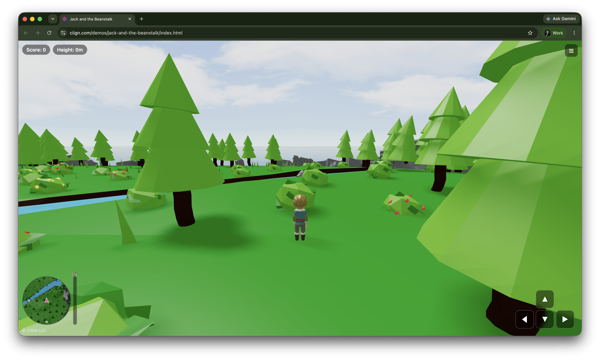

# Jack and the Beanstalk

A 3D browser game built with Three.js. Climb the beanstalk, collect golden beans, dodge the clouds, and reach the giant's castle at the top.

Play it at [ciign.com/demos/jack-and-the-beanstalk](https://ciign.com/demos/jack-and-the-beanstalk/index.html).



## Controls

Arrow keys or WASD, or the on-screen buttons on touch devices.

| On the ground | On the beanstalk |
|---------------|------------------|
| ▲ ▼ run forward / back | ▲ ▼ climb up / down |
| ◀ ▶ turn | ◀ ▶ circle around the stalk |
| Walk into the stalk with ▲ to grab it | Press ▼ at the bottom to let go |

The minimap (bottom left) shows the island from above with Jack, the stalk, and remaining beans; the bar beside it is your progress to the castle at 100m. Jack cannot walk into water or off the island.

Golden beans are worth one point. Clouds knock you down the stalk and cost a point. The beanstalk keeps growing while you climb.

## Develop

```bash
npm install
npm start        # dev server on http://localhost:9000
npm run build    # production build in dist/
```

Plain JavaScript, no framework. `src/js/game.js` owns the loop, camera, and UI; `player.js` is the ground/stalk controller; the rest are one module per scene object.

## License

MIT. © CIIGN LLC.
